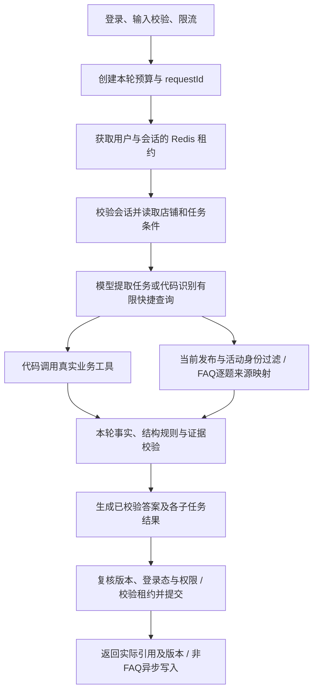

# 可靠执行业务 Agent：设计依据与可验证边界

V1只读、单店，最多核对本轮展示的5张优惠券；支持明确星期、买券预算和支付最少／抵扣最多。客服问答作为其中一项能力，消费者使用消费向导完成查询、比较与条件核对。

## 请求怎样成为可信结果

`CustomerTask`表达本轮请求的能力、原文条件、FAQ子问题和缺失信息；`AiBusinessFacts`只接收实际执行器写入的本轮事实。模型可以提出任务与候选判断，店铺ID、金额计算、库存和已确认的星期资格由业务接口与代码决定。响应通过`task.status`与`steps`报告完成、部分完成、澄清、未知、拒绝或失败；`faqAnswers`逐题列出原文、状态、来源和原因，`evidence`提供实际采用的文档及发布版本。

FAQ来源模型只接收提取后的平台子问题与发布知识，一轮映射最多5题。共享任务解析先严格校验原9字段，再用本轮连续原文恢复已识别的问句范围和独立咨询；同题细节保留，明确否定和选券条件排除，超限或无法对应仍拒绝。句界标点的范围映射不会取消原始引用校验。`FaqAnswers`验证逐题来源，绑定不可变内容快照，并在渲染时再次核对；最终通用模型的来源声明不能越过这个批准结果。`FaqEvidenceCoverage`另查已识别的到账时限、费用、保证、使用限制、查看位置及操作步骤：相关主题、无关数字或查看指引不能替代所需事实，评论数不能证明体验正文的位置，验证码位数不能充当有效期，钱包充值时限不能充当退款时限。只有部分依据时保留对应来源，逐题返回PARTIAL及`missingDetails`，没有依据则UNKNOWN；日志只增加缺失数量。有限词法检查不是通用语义蕴含证明；整项FAQ能力遗漏、未识别表达、适用条件、概念解释充分性和跨文档语义冲突仍是剩余风险。

逐份来源还需贡献已识别的主题、字段或必要事实。明确退出后的登录态、同一用户同张券的次数限制和点赞排序关系，不能由一般功能说明代替；登录步骤不能充当退出步骤。多份互补资料继续保留，已知部分不因另一项缺失而丢弃。点名人均和评分但只有人均时返回PARTIAL及“评分信息”；零批准来源不能COMPLETED。未知表达保持既有后备路径，字段名称命中也不证明数值或解释齐全。

明确询问购买金额和抵扣金额的含义时，两项定义分别作为必要事实；字段列表和单纯数字不足以完成概念题。该检查仍复用`Detail`，一份或多份定义都经同一批准路径，部分定义保留为PARTIAL。v7优惠券说明补充交易代码已有的定义，不根据两个价格字段臆测可用性，也不将该有限模式推广为通用概念理解。

采用有限工作流与受控模型回合，是因为当前业务步骤和权限范围已经明确。新增通用编排组件前应先证明现有流程无法覆盖真实需求；Anthropic也将从简单方案起步、按需求增加复杂度作为其工程建议。这里据此作项目取舍，不推导通用架构排名。[Building effective agents](https://www.anthropic.com/engineering/building-effective-agents)

## 三类数据为何采用不同的故障策略

| 数据 | 角色与边界 | 故障处理 |
| --- | --- | --- |
| Redis会话、店铺与任务条件 | 决定本轮“这家店”“改成周日”指什么，是权威上下文 | 读失败立即拒绝；不能按空历史继续回答 |
| 本轮业务DTO、交易域确认规则、发布FAQ | 决定事实与资格的证据 | 不可用时报告失败、未知或部分完成；不能沿用旧价格和库存 |
| Milvus历史向量、可视化工具日志 | 辅助召回与观察，不授予权限、不生成实时事实 | 可降级；日志保存失败不能把已经提交的结果改成失败 |

短期状态保存在Redis；模型只接收经校验的实体与任务条件，当前客服路径不再检索或拼入自由文本历史。包含FAQ的回答也不写历史向量，避免正文脱离当前版本及权限后重新进入模型。历史向量组件仍保留，非FAQ写入使用有界异步队列；这不保证必达，也没有替代会话存储。

工具日志采用`用户+会话+requestId`独立键，每条记录携带响应的requestId并保留2小时。调用方必须按本轮ID读取，不能通过内容是否变化来猜测轮次；迟到记录与新记录使用不同键。旧的仅按会话查询接口不再提供“最新”回退。

## 文档版本和权限怎样进入证据

在线默认由MySQL当前发布指针连接完整不可变清单，索引只负责召回。每份清单有发布标签和完整文件SHA-256，每条文档有独立版本、发布状态与显式访问策略；缺权限声明或同一ID有多个发布版本时拒绝候选。文本和权限枚举使用严格输入类型，禁止数字/布尔值变成文本、禁止枚举数字序号。classpath/file只作为显式离线与受控验证模式。

受保护的发布端点要求内部凭证与专属发布凭证，先校验整个候选，再用MySQL事务核对ETag、绑定文档版本、追加快照和切换指针。失败候选不替换有效发布，数据库不可读取或当前快照损坏时停止知识查询；不能回退某个实例自己的旧文件。回滚旧快照也递增generation，避免A→B→A后旧ETag复活。数据库事务只覆盖发布，不持有模型、Embedding或会话Redis调用。

不同ID可声明`rules`：规则键、适用范围、规范取值及所在正文原文片段。同键同scope的不同值，仅在文档生效时间与门店集合都相交时冲突，在共享发布激活前拒绝候选；同值重复、相邻时段或不重叠门店不会因此冲突。共享模式保留上一份有效发布，显式文件模式读到冲突清单时知识不可用。元数据属于发布指纹。声明由可信发布者审核，片段存在不证明语义等价；可选声明没有覆盖未标注的自然语言矛盾，范围也不能替代ACL或自动证明用户适用性。

文档的effectiveFrom／effectiveUntil按含开始、不含结束执行，使用带偏移量的时间点和服务器UTC时钟，shopIds仅约束事实适用门店。查询、外部重排前、生成前和返回前均复核有效性；证据快照保留查询范围，不能丢失后继续使用门店资料。当前平台FAQ不根据浏览页推断门店适用性，具体券规则由交易工具处理。完整发布预先索引未来资料，生效切换无需新指纹或重建向量，时间到了仍须由查询白名单过滤。历史订单、未来交易口径及任意业务对象推断尚未实现。

可信身份来自网关，外部伪造身份头先被清除。受限读取另外要求本轮HTTP令牌仍在Redis中绑定同一用户，退出、过期、错配或无法确认时不沿用身份快照。根据当前清单、可信角色快照及已确认的用户ID得到可读文档集合，再按发布指纹与可读ID过滤Milvus查询。返回结果必须属于该次获准集合，并另查有限分数及当前版本；原文从清单取，索引正文不能覆盖它。重排与来源模型之前再次核对，不能先把无权正文发送出去再过滤展示。纯公开清单不引入这项登录态依赖。

提交前重新检查已选证据；更新或撤权后FAQ降为未知，独立的已核实子任务保留。当前只支持USER/ADMIN角色及指定用户授权，缺SSO/部门组织关系。它是多次请求内复核，不是跨网络与Redis的事务；最后检查后仍有并发窗口，已经发出的副本不能收回。

新发布指纹尚无就绪向量时使用当前授权文档的关键词回退。后台默认每15秒检查，为当前发布建立独立批次；完整数量确认、当前发布和共享租约均有效时才原子启用就绪指针。检索增加批次过滤与强一致性，未就绪数据不能提前参与回答。失败按发布共享退避，旧任务不能启用结果或释放新锁；后台与查询使用不同熔断场景。

已明确失败的未发布批次可清理，确认超时则保留状态不明的数据。旧就绪命名空间保留供回滚，不作为当前证据回退；共享数据库提供共同发布状态，尚未实现完整的孤立数据回收、历史索引保留期或多主数据库容灾。

## 会话一致性保证到哪里

同一用户、同一会话只允许一轮持有租约。不同用户即便传入相同conversationId，仍使用不同键。轮次中修改先保存在`Turn`，提交时Lua再次检查owner，再保存问答、实体和任务条件。过期的旧owner不能覆盖新轮次。

Lua让所有者检查与多个Redis操作在执行期间不被其他命令穿插；它不等于跨服务事务，也不能保证客户端一定收到提交确认。[Redis Lua执行语义](https://redis.io/docs/latest/develop/programmability/eval-intro/)

因此，提交超时返回`CONVERSATION_UNAVAILABLE`，含义是状态无法确认。服务器不会自动重复追加，也不声称已经回滚。当前工具只读，没有交易副作用；若未来加入下单或退款，需要另行定义业务幂等、用户授权和结果查询协议。

历史读取已采用完整问答对契约：任意坏JSON、字段类型错误、乱序或半轮均拒绝整轮，不再跳过。旧店铺状态可识别升级，JSON null和未知根格式被拒绝；旧逐条写入入口已移除。TTL、偶数消息数和字符上限在Bean初始化时验证。当前检查覆盖存储格式和已知边界，持久化任务内部的全部业务语义仍需继续审查。

## 并发、熔断与截止时间

同节点的外部调用共用有界并发许可，各场景维护独立熔断器。冷却后只放行一个恢复探测。每次打开熔断器都会递增代次；获准请求只可更新所属代次的状态。

| 事件 | 状态变化 |
| --- | --- |
| A、B在第0代获准；A失败达到阈值 | 熔断打开，进入第1代 |
| 冷却结束，C成为第1代恢复探测 | 其他探测仍被拒绝 |
| 旧请求B迟到失败或成功 | 记录调用结果，忽略其对第1代熔断状态的修改 |
| C返回并通过协议校验 | 关闭第1代熔断；新的请求可进入 |

模型次数、工具次数、Token准入额度及请求截止时间共享同一请求预算。模型次数与Token一起准入，Token不足时不增加调用次数。Token是准入估算，已知usage用于校正；这不是供应商账单硬上限。

模型调用许可覆盖响应解析，协议失败与普通参数错误采用不同异常。FAQ漏题时已核实部分仍可交付，但许可记录失败，不能关闭半开熔断；完整返回空来源属于合法UNKNOWN。预算、时限与准入拒绝即使被框架包装，也不增加供应商失败计数。模型调用成功、协议有效和业务完成分别记录。

任务提取的明确格式、类型、枚举及非原文引用错误可纠正一次；使用同一个`task`熔断场景、原始输入和请求预算，可信协议只追加固定分类及字段枚举，不重放坏响应。长度、项数、子任务越界、未分类及传输故障不触发这次纠正。额外提取消耗已有回合与时间，后续步骤仍可能因额度或截止时间停止；它不证明任务完整或业务事实成立。

截止时间在关键边界检查，网络调用另设超时；它不是操作系统级硬取消。并发许可和熔断器目前按节点生效，多实例部署后的总并发会增加。异步记忆也使用同一外部调用并发池，尚未通过混合负载实验确认是否影响交互请求。

## 已落实的架构修复

1. 会话历史读取错误不再降成空历史；锁获取、会话读取和提交不可确认统一返回可识别原因。清理锁再次失败时保留原始异常。
2. 熔断许可绑定代次，解决旧请求释放新探测位、在恢复后重新熔断的问题。两条定向测试在旧实现中失败，修复后通过。
3. 模型回合与Token联合准入，避免未调用模型却增加调用计数。
4. 组合任务把FAQ来源选择与选券模型分别执行、分别解析，再由代码合并。选券协议或供应商失败不能抹掉已选发布来源，FAQ失败也不阻断已核实业务结果；总预算和截止时间仍中止整轮。
5. 模型字段只作提议：服务端校正重复的星期要求和与已验证页面实体冲突的continuation标记；人数结论必须至少引用涉及人数的规则，相关性仍不等于完整语义证明。
6. FAQ按本轮原文片段检索、逐题映射来源，再由不可变校验结果决定完成；组合任务缺少子问题范围时澄清。使用指导与实时实体查询分别执行，新增必要主题检查同时回归验证码等正例，避免只测拦截而漏掉误拒绝。
7. 任一损坏消息都拒绝读取，保留历史与状态；仅整轮写入，初始化拒绝非法保留配置。故障日志保留原因类型与清理计数，避免异常堆栈带出存储原文。
8. 模型接口作为外部依赖按契约预检。当前接口的原生多消息未通过对照；显式单消息适配后，按实际封装检查协议与嵌入上下文，不能冒称原生角色能力已恢复。HTTP成功或readiness为UP仍不足以证明业务正确。
9. 协议解析纳入同一次模型许可；类型化响应错误计入熔断，部分漏题与正常未知分别处理。native两条路径及包装后的本地拒绝均有定向回归。
10. 文档版本、访问策略及当前发布指纹贯穿召回、重排、模型输入和提交前检查；旧FAQ不会经自由历史重放。来源真实性仍与语义充分性分别记录。
11. 满足本轮快照、库存、预算和条件策略的候选按代码排序；未知条件偏好保留原文并跨轮继承/替换，复杂或矛盾表达先澄清。
12. 当前代理显式使用单消息封装服务端协议与JSON数据，默认接口行为不变；严格解析和权限门禁保留。兼容模式与native Skill组合在启动时拒绝，不模拟工具消息角色。
13. 已定义的FAQ细节由代码核对；预计时间不等于到账保证，退款金额不等于手续费。支持一部分事实也可逐题PARTIAL，不通过增加模型字段或回合来声明事实已被证明。
14. 已声明规则按键和范围在发布边界核对一致性，冲突不由向量排名或模型选边；权限枚举拒绝数字序号，受限正文不能因`visibility: 0`变成公开。
15. 模型任务输入也显式拒绝数字枚举、隐式标量转换、布尔null及重复键。拒绝诊断使用固定分类和字段枚举；未知属性不暴露名称，不记录原文或解析堆栈。坏任务提议不提交，同会话可恢复，调用预算和事实门禁保持原约束。
16. 已分类任务提取错误至多纠正一次，打开或半开熔断可阻断纠正，本地预算拒绝不增加供应商失败。坏任务提议不提交；经过任务校验后的业务失败可按既有规则提交，不能仅凭API的`success=false`混为一类。
17. 已识别的位置和方法问题需要对应入口或操作说明；同文档中的无关步骤和数量字段不充当体验内容证据。凭证放在请求头等有效表达保留为正例，代码与发布正文共同核对，未增加模型回合。
18. 已声明FAQ能力时，用原文恢复已识别的被截断问题和遗漏独立题；退款与验证码等细节按主体绑定。带前缀问句、短信陈述上下文和完整否定转折保留正向对照；没有扩展模型协议、预算或安全权限。
19. 受限知识在召回、外部模型前和提交前绑定活动登录。旧身份快照不能延长已退出会话的授权；纯公开清单无新增登录态依赖。角色仍是网关快照，未接入组织权限变更广播。

## 后续验证与扩展

当前有限规则和细节检查不能证明任意自然语言结论。未声明的语义冲突、未识别问法和复杂使用条件仍需真实资料审核与独立评测。

多主数据库容灾、组织权限变更广播、孤立索引回收和跨服务线性一致性不在 V1 范围。最后一次权限复核之后仍有并发窗口，已经发送的副本不能收回；并发池、熔断器按节点工作，当前没有混合负载容量承诺。

新增选券约束需先定义业务事实、规则与多轮替换语义，再验证候选、澄清和未知结果；新增写操作另行设计授权、确认、幂等与审计。

运行方式与回归入口见 [README](README.md)，知识操作见 [发布手册](evaluation/KNOWLEDGE-PUBLICATION.md)。
