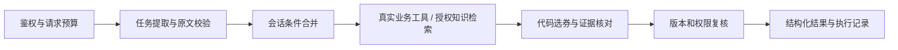

# LifeFlash 消费决策 Agent

面向校招展示的只读业务 Agent：帮助消费者查询真实店铺、比较单店优惠券、修改消费条件，并核对平台规则。客服问答是其中一项能力，网页消费向导提供交互入口。

模型提取意图、原文条件和候选来源；代码负责身份、实体绑定、工具执行、金额计算、规则判断、证据与最终状态。当前使用 Spring Boot、LangChain4j 1.22.0、MySQL、Redis 和可选 Milvus，不执行下单、支付、退款或核销。



## 能力与边界

| 能力 | 实现范围 | 边界 |
| --- | --- | --- |
| 真实查询 | 店铺、优惠券、库存与探店笔记；实体不明确时澄清 | 不从店名中的数字猜 ID，不把历史回答当实时事实 |
| 多轮选券 | 单店、明确星期、买券预算、支付最少／抵扣最多；换店清空旧条件 | 最多核对本轮展示的 5 张券；人数、叠加、相对日期及复杂目标可能需要澄清或确认 |
| 知识更新 | MySQL 共享发布指针、不可变修订、ETag 条件发布、递增代次的回滚 | 已有数据库需先执行迁移；共享权威不可用时停止知识查询 |
| 版本冲突 | 对相同规则键、范围、相交生效时间和门店集合的冲突阻止发布 | 未声明的自然语言矛盾仍需审核 |
| 文档权限 | 活动登录绑定、显式 ACL；召回、外发和返回前复核 | 支持 USER／ADMIN 和指定用户，未接入部门目录或 SSO |
| 证据与未知 | FAQ 逐题来源、版本、缺失细节与部分完成；业务事实由工具提供 | 有限主题和细节检查不等于通用语义证明 |

交易服务维护经确认的星期政策，包含版本、原文摘要和允许星期。规则缺失、未确认或正文变化时返回未知。价格和库存只代表查询时刻的事实，不预留库存或保证核销。

`task.status` 区分 `COMPLETED`、`PARTIAL`、`NEEDS_CLARIFICATION`、`UNKNOWN`、`REFUSED`、`FAILED`；`steps` 列出各能力的状态与原因，`faqAnswers` 逐题返回来源和 `missingDetails`，`evidence` 绑定文档版本和发布版本。前端显示查询时间、未确认的原文使用要求，并通过请求代次检查和取消请求隔离账号、门店与新会话。

## 启动与配置

从仓库根目录按主项目的 Docker Compose 流程启动。新数据卷自动执行知识发布表迁移；已有数据库先执行 [add_ai_knowledge_publication.sql](../deploy/mysql/add_ai_knowledge_publication.sql)。服务默认关闭外部模型，在线知识模式默认为 `shared`。

在本地被忽略的 `.env` 设置 `LANGCHAIN4J_ENABLED=true`，并配置 `HMDP_AI_OPENAI_API_KEY`、`HMDP_AI_OPENAI_BASE_URL`、`HMDP_AI_OPENAI_MODEL`。项目专属变量优先于宿主通用 `OPENAI_*` 配置。接口必须支持本项目的任务协议，不能仅以 HTTP 成功认定模型可用。

知识管理还需设置独立的 `HMDP_AI_KNOWLEDGE_PUBLISH_TOKEN`，并向共享库发布初始清单；未配置凭证时管理接口拒绝请求。发布、回滚、ACL 与文件模式的操作见 [知识发布手册](evaluation/KNOWLEDGE-PUBLICATION.md)。显式离线验证可设置 `HMDP_AI_KNOWLEDGE_RESOURCE=classpath:knowledge/customer-service-v1.json`。

默认预算为每轮最多 4 次模型调用、4 次工具调用、12288 Token 准入额度及 25 秒截止时间；模型单次超时 10 秒、SDK 重试为 0。真实用量取自供应商响应，准入估计不代表计费上限。

`voucher-selection` Skill 提供流程说明，不授予权限或充当事实来源。显式启用时可选 `inline`／`native`；默认关闭。仅对经过验证会丢失前序消息的代理开启 `HMDP_AI_SINGLE_MESSAGE_COMPAT=true`；该模式要求 `inline` 或关闭 Skill，不支持 native 工具角色，也不放宽解析和证据校验。

## 验证

从仓库根目录运行：

```powershell
mvn -pl hm-ai-service,hm-trade-service -am clean test '-DskipTests=false'
node frontend/tests/ai-session-regression.cjs
python hm-ai-service/evaluation/run_live.py --self-check
```

Java 回归覆盖会话隔离、预算与熔断、任务协议、FAQ 证据、ACL、发布与选券。真实 MySQL 事务测试需设置 `LIFEFLASH_KNOWLEDGE_MYSQL_URL`、`LIFEFLASH_KNOWLEDGE_MYSQL_USER`、`LIFEFLASH_KNOWLEDGE_MYSQL_PASSWORD`，并在专用测试库执行上述迁移；未设置 URL 时这组测试跳过。前端回归故意让网络请求忽略取消信号，检查迟到回复仍不能串账号或门店。

可复用的真实接口评测只访问本机 Docker，为各场景创建独立的合成账号。启动并配置服务后，选择未使用的测试手机号段和新的结果目录：

```powershell
python hm-ai-service/evaluation/run_live.py --output output/ai-eval/new-run --phone-start 19920000000
python hm-ai-service/evaluation/analyze_live.py --help
python hm-ai-service/evaluation/run_model_contract_probe.py --output output/ai-eval/model-probe
```

评测记录协议、工具、用量和耗时，不自动评定完整语义准确率。历史日志、截图、模型响应、机器环境记录和临时实验文件留在本地，仓库保留可复用脚本及测试数据。

## 演示与追踪

在具体门店页打开消费向导，输入“星期一去这家店，买券预算 80 元，选支付最少的”，再修改星期或改为“抵扣最多”，查看重新查询的候选、未入选原因及查询时间。追加“保证退款 15 分钟到账吗”，观察无依据的子问题返回未知；人数或晚间使用条件缺乏规则时应明确待确认。

每轮返回 `task.requestId`。使用 `GET /api/agent/logs/{conversationId}?requestId={task.requestId}` 查询该用户本轮的执行记录；每轮独立保留 2 小时，不能省略 requestId 读取其他轮次。兼容字段 `thought` 是服务端步骤说明，不代表模型私有推理。

详细的数据权威、发布一致性、权限和故障边界见 [架构说明](ARCHITECTURE.md)。
